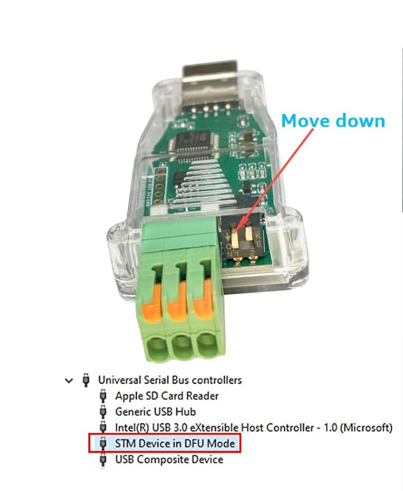
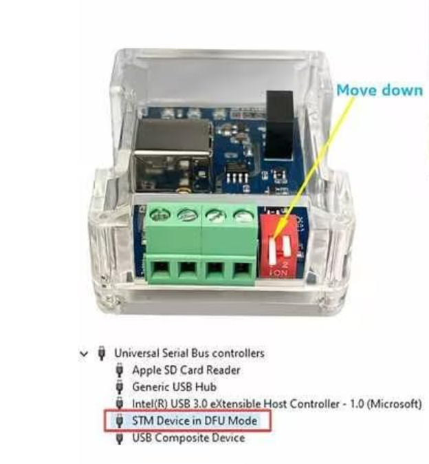
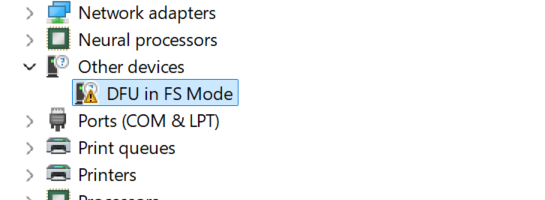
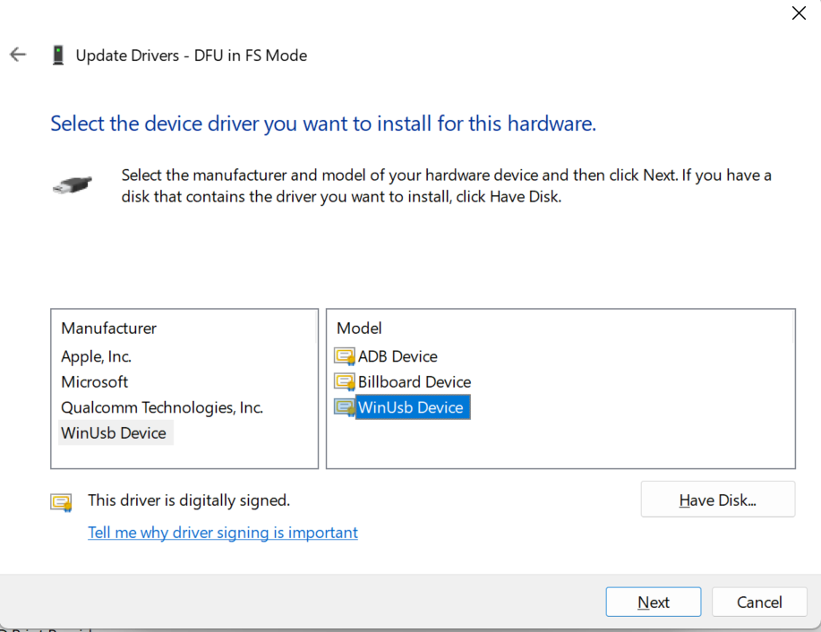
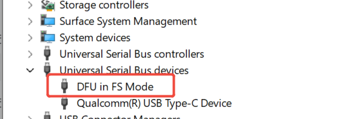
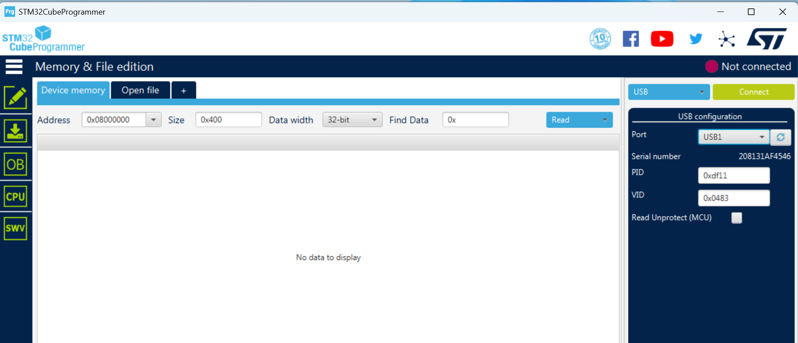
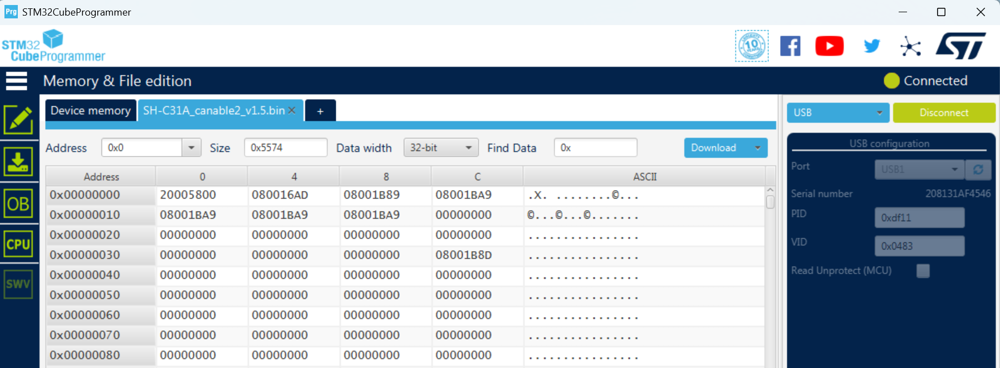

<!-- SPDX-FileCopyrightText: 2026 DongGuan DESHIDE TECHNOLOGY CO., LTD (DSD TECH) -->
<!-- SPDX-License-Identifier: CC-BY-SA-4.0 -->
# Updating SH-C31A and SH-C31G firmware on Windows

> **Review draft.** The steps below have been checked against our existing
> firmware instructions, the product owner's confirmations and supplied images.
> A complete clean-Windows walkthrough has not been newly tested for this guide.
> See [Validation limits](#validation-limits) for outstanding items. If you
> cannot identify your switch, device or expected result, stop and ask for help.

This guide covers **SH-C31A and SH-C31G** using the original upstream
canable2 build or DSD TECH v1.4 gs_usb firmware, upgrading to **DSD TECH v1.5** over USB with
**dfu-util 0.11**. Both models use the same firmware file, whose name starts
with `SH-C31A`. This does not mean an SH-C31G needs a different download.

DSD TECH v1.5 is the latest DSD TECH build at the time of this guide. If your
adapter already runs v1.5, there is no newer DSD TECH version to install here.
The final appendix explains how to unlock an adapter already on v1.5 before
changing to a different firmware, such as ElmueSoft Slcan 2.5.

The main upgrade procedure does not cover SH-C31B, SH-C30-series adapters,
SH-C32A, or changing from
ElmueSoft or other third-party firmware. If Windows shows a COM port, or the
installed firmware is unknown, do not select a procedure from the table below
based only on the enclosure or circuit-board marking.

## Before you start

- You need one SH-C31A or SH-C31G, a Windows computer and a stable USB connection.
  SH-C31A has a USB-A plug; SH-C31G needs a USB cable with a Type-B connector
  at the adapter end. Any cable used must carry data.
- Disconnect the CAN terminal wiring and any attached external equipment before
  updating. Close diCAN and other programs that could open the adapter.
- Connect only the one adapter you intend to update. Disconnect other CAN
  adapters and STM32 DFU devices so the commands cannot select the wrong unit.
- Firmware programming is done over USB. You do not need another CAN device.
- Use only one programming tool at a time. If STM32CubeProgrammer is
  Connected, click Disconnect before using dfu-util; do not leave its USB
  connection open in the background.
- Do not unplug the adapter or shut down the computer while programming.
- A USB device driver and a USB application are different things. Installing or
  starting dfu-util does not by itself bind the correct driver to the device.

Already running v1.5? You normally do not need to flash it again. Installing
the firmware again is not necessary just to use CAN FD on our v1.4/v1.5 builds.

## 1. Check your computer and your current firmware

### Computer

Open **Settings → System → About** and record the Windows version and
**System type**. Identify whether the processor is x64 or ARM64.

| Computer | Tool path in this draft | Validation boundary |
|---|---|---|
| Windows x64 | `win64` dfu-util executable and its accompanying DLL; use normal Windows device recognition, no manual binding step | Recognition confirmed by product owner; full guide walkthrough pending |
| Windows 11 ARM64 | The same x64 executable under Windows emulation, with its accompanying x64 DLL; manual WinUSB binding only in ROM DFU, no Zadig | Manual selection of the built-in WinUsb Device is owner-confirmed; exact Windows build and full walkthrough transcript pending |
| Windows 10 ARM64 / Windows x86 | Not covered by the selected `win64` route | Do not follow this route; request a separately verified procedure |

Windows 11 can emulate x64 applications. This does **not** emulate x64 kernel
drivers: device drivers must support the actual ARM64 operating system.
See [Microsoft's explanation of Windows on Arm emulation](https://learn.microsoft.com/en-us/windows/arm/apps-on-arm-x86-emulation).

### Adapter

1. Leave the BOOT switch in its normal running position and connect the adapter.
2. Open **Device Manager** (right-click Start → Device Manager).
3. Find the device added when you connect it. It may appear under USB devices;
   its category/name can differ when the driver is missing.
4. Open **Properties → Details → Hardware Ids**. Record the full ID and the
   device name. Look for the VID, PID and revision below.

| What you see | Meaning | Upgrade path |
|---|---|---|
| `VID_1D50&PID_606F`, DSD TECH / `SH-C31x`, `REV_0215` | Our v1.5 | No newer DSD TECH build here; stop the normal upgrade flow. For a deliberate firmware change, see the final appendix |
| `VID_1D50&PID_606F`, DSD TECH / `SH-C31x`, `REV_0200` | Our v1.4 | Use step 5A |
| Confirmed original upstream firmware | Older supported starting point | Use step 5A |
| `VID_0483&PID_DF11` | STM32 ROM bootloader / DFU mode | Application version cannot be identified in this mode; see troubleshooting |
| COM port, a different firmware, or uncertain identification | Outside the identified starting paths | Stop and request identification help |

The IDs distinguish running firmware from the ROM bootloader. They do not
identify the physical model by themselves. Do not assume that every unfamiliar
USB name or revision is the original upstream firmware.

## 2. Download and prepare dfu-util

1. Download [dfu-util 0.11 binaries from the official project](https://dfu-util.sourceforge.net/releases/dfu-util-0.11-binaries.tar.xz).
2. Extract the archive fully. If Windows does not offer extraction for
   `.tar.xz`, use an archive tool that supports it. Some tools require two
   extraction steps: `.xz` to `.tar`, then `.tar` to the actual folders.
3. Create a folder called `SH-C31-update` inside your Windows **Downloads** folder.
4. From the extracted `dfu-util-0.11-binaries/win64` folder, copy
   **`dfu-util.exe` and `libusb-1.0.dll` together** into `SH-C31-update`.
   Keep the supplied x64 DLL with the x64 executable, including on ARM64.
   Do not copy it into Windows system folders or substitute an ARM64 DLL.
5. Open `SH-C31-update` in File Explorer. Type `powershell` in the address bar
   and press Enter. Use that PowerShell window for the following commands.

```powershell
.\dfu-util.exe --version
```

**Expected:** dfu-util reports version `0.11`. If the program does not start,
or reports a missing DLL, stop here. Check the extraction and that both files
are in this folder. A working version command proves only that the tool can
start; it does not test the USB driver or the adapter.

## 3. Download the firmware and check the file

Download these three files into the same `SH-C31-update` folder:

- [SH-C31A_canable2_v1.5.bin](https://github.com/dsdtech-official/can-adapters/releases/download/SH-C31A/fw-v1.5/SH-C31A_canable2_v1.5.bin)
- [SHA256SUMS.txt](https://github.com/dsdtech-official/can-adapters/releases/download/SH-C31A/fw-v1.5/SHA256SUMS.txt)
- [THIRD-PARTY-NOTICES.md](https://github.com/dsdtech-official/can-adapters/releases/download/SH-C31A/fw-v1.5/THIRD-PARTY-NOTICES.md)

The [v1.5 Release page](https://github.com/dsdtech-official/can-adapters/releases/tag/SH-C31A/fw-v1.5)
also has `.dfu` and `.hex` files. This guide deliberately uses **only `.bin`**
with the existing documented write command. Do not replace the filename with
`.dfu` while keeping the raw binary address option.

Your working folder should now contain:

```text
SH-C31-update/
  dfu-util.exe
  libusb-1.0.dll
  SH-C31A_canable2_v1.5.bin
  SHA256SUMS.txt
  THIRD-PARTY-NOTICES.md
```

In PowerShell, run:

```powershell
Get-FileHash .\SH-C31A_canable2_v1.5.bin -Algorithm SHA256
Get-Content .\SHA256SUMS.txt
```

Compare the 64-character hash with the line for **exactly
`SH-C31A_canable2_v1.5.bin`**. Uppercase/lowercase does not matter; every digit
must match. If it does not match, do not flash. Download again from the official
Release and check again. Keep the licence notice with the firmware if you
redistribute or mirror it.

## 4. Identify the BOOT switch before disconnecting anything

**BOOT** selects firmware-update startup. The **120 Ω termination** switch
controls CAN wiring termination and is a different function.

### SH-C31A: DFU switch position



With the **USB plug at the top and the green CAN connector at the bottom**, as
shown in this supplied picture, move the **BOOT lever indicated by the red
arrow down, toward the CAN connector**, to select DFU startup. Do not move the
other lever to perform this step. The lower part of the supplied picture shows
an example device name, **STM Device in DFU Mode**. Still verify `0483:DF11`;
this lower screenshot is a general identification example, not the ARM64
before-binding screen. Use the dedicated ARM64 images in section 5C.

**On v1.5 this switch setting alone is insufficient:** first unlock while the
firmware is running, then disconnect USB, move the lever and reconnect as in
the final appendix. From v1.4 or the confirmed original upstream build,
follow the main upgrade procedure in step 5A.
The photograph's “Move down” note does not remove the unlock requirement.

### SH-C31G: DFU switch position



Use the orientation shown in this supplied SH-C31G picture: the USB connector
is above the green CAN terminal. Move the **BOOT lever indicated by the yellow
arrow down, toward the terminal**, to select DFU startup. Do not move the
other lever as part of this operation. The picture also contains a general
Windows **STM Device in DFU Mode** example; the dedicated ARM64 screenshots
below show its separate driver states.

The downward DFU direction is product-owner-confirmed for both model pictures.
An adapter already running v1.5 still needs the unlock described in the final
appendix before a future firmware change; moving the switch alone is not enough.

For **both models, in the orientations shown above**, BOOT **down** selects
DFU and BOOT **up** (the opposite direction) is the **normal running position**.
Move only the indicated BOOT lever, with USB power disconnected. Return it
up after writing, before reconnecting USB for normal operation.

## 5. Enter DFU mode

**Main path: our v1.4 or a confirmed original upstream build → v1.5.**
If step 1 identified v1.5, stop this normal upgrade path; see the final appendix
only if you deliberately intend to change firmware.

### 5A. Starting from our v1.4 or a confirmed original upstream build

1. Close CAN applications and disconnect USB.
2. Move BOOT to the DFU position.
3. Reconnect USB. No v1.5 unlock command is required for these starting builds.
4. Continue with **5B**.

### 5B. Confirm ROM DFU in Windows and choose the driver route

In Device Manager, locate the adapter and inspect **Properties → Details →
Hardware Ids**. Confirm **`VID_0483&PID_DF11`**. The running application's
`1D50:606F` ID is not ROM DFU; if it remains, recheck step 5A; for an adapter already on v1.5, use the final appendix.

- **Windows x64:** Windows recognizes ROM DFU normally in the product owner's
  tested setup. No manual binding is required; skip 5C and continue to **5D**.
- **Windows 11 ARM64:** before binding, the supplied screenshot shows
  **Other devices → DFU in FS Mode** with a warning icon. Continue to **5C**
  to select WinUsb Device, then **5D**. If this DFU device already has a working
  WinUSB binding, leave it unchanged and proceed directly to 5D.

Being visible in Device Manager confirms presence, not dfu-util access.
Do not start writing at this point.

### 5C. Windows ARM64: bind the ROM DFU driver

The product owner's testing confirms that **only Windows ARM64 in ROM DFU
mode needs manual WinUSB binding in this procedure**. Windows x64 recognizes
the device normally. Do not add a manual driver-installation step to normal
operation, and do not use Zadig on ARM64.

| Computer and USB state | Hardware ID | Driver route |
|---|---|---|
| Windows x64, normal operation or ROM DFU | `1D50:606F` or `0483:DF11` | Allow Windows to recognize the device normally; no manual binding step. Verify access using the appropriate dfu-util listing. |
| Windows ARM64, normal operation / runtime interface | `1D50:606F` | No manual binding is required by this procedure. If access fails, collect the error and ask for help instead of changing the working application interfaces. |
| Windows ARM64, ROM DFU | `0483:DF11` | Manually bind WinUSB for this DFU device, then verify it is accessible. Do not use Zadig. Select the built-in WinUsb Device using the steps below; no additional INF is needed. |

**To inspect:** Device Manager → the matching device/interface → Properties →
Details → Service, and Driver → Driver Details. A WinUSB binding normally shows
service `WinUSB` and the system `winusb.sys` driver. Record any error code.
Device presence alone is not proof that dfu-util can open it.

#### Select the built-in WinUsb Device

**This step applies only to Windows ARM64 after the adapter has entered ROM
DFU mode.** The product owner has tested and confirmed manual selection of
**WinUsb Device** in Device Manager, with **no additional INF file**. Do not
use Zadig or download a separate driver package for this procedure. Windows
x64 users skip this subsection.

1. After step 5B has identified the adapter in ROM DFU mode, open **Device Manager**.
   Expand **Other devices** and look for **DFU in FS Mode**, shown with
   a warning icon in the supplied ARM64 screenshot below. This is the
   before-binding state; a name alone is not enough to identify the device.
2. Right-click that device → **Properties → Details → Hardware Ids**.
   Confirm **`VID_0483&PID_DF11`**. If it shows `1D50:606F`, it is still
   running the application: return to step 5A, or the final appendix for v1.5, instead of changing its driver.
3. Close Properties. Right-click the confirmed DFU device → **Update driver**.
4. Choose **Browse my computer for drivers**, then **Let me pick from a list
   of available drivers on my computer**. These choices select a driver
   already available in Windows; you are not browsing for a downloaded INF.
5. If Windows first asks for a device class, select **Universal Serial Bus
   devices**. If it goes directly to the model list shown below, continue
   there. In the two-column selection screen, choose **WinUsb Device** in
   the left **Manufacturer** column, then **WinUsb Device** in the right
   **Model** column. Do not select ADB Device or Billboard Device.
6. Choose **Next** and allow Windows to complete installation, then close
   the dialog. **Do not choose Have Disk...** No external INF file is needed.
7. After the installation dialog completes, continue to **step 5D** to verify
   that dfu-util can access the DFU device. Driver selection alone is not the
   final success check.

**Before binding on Windows ARM64:**



**Manual driver selection for that DFU device:**



The preceding two screenshots were supplied for this ARM64 DFU procedure. The selection
window title is **Update Drivers - DFU in FS Mode**, matching the before-binding
device name. They do not display hardware IDs or the completed installation;
verify `0483:DF11` in driver step 2 and dfu-util access in section 5D.

**After successful binding on Windows 11 ARM64:**



The product owner supplied this as the successful WinUSB-binding result:
**DFU in FS Mode** now appears under **Universal Serial Bus devices**, without
the earlier warning icon. The display name remains **DFU in FS Mode**; a name
change is not required. Verify dfu-util access in section 5D before writing.
The picture does not display the hardware ID, driver service or a firmware
write result, and does not replace that access check.

If **WinUsb Device** or the expected device class is missing, or Windows reports
an installation error, stop and record the Windows version/build, hardware ID
and complete error. Do not choose an unrelated model, force an incompatible
driver, load a random INF, edit the registry or disable signature enforcement.
The confirmed built-in-driver route is the only ARM64 binding route covered
here. A device that already has a working WinUSB binding need not be rebound.

The installed kernel driver on ARM64 must be ARM64-compatible even when
dfu-util runs under emulation. Do not substitute an x64-only kernel driver,
use Zadig on ARM64, or disable driver-signature enforcement.

### 5D. Verify DFU access before writing

```powershell
.\dfu-util.exe -l -d 0483:df11
```

**Expected:** a DFU device with USB ID `[0483:df11]`, including alternate setting
`alt=0` for internal flash starting at `0x08000000`. The flash size can differ
between fitted MCU variants. Multiple alternate-setting lines for one device
are not by themselves multiple adapters.

Do not proceed unless the **internal flash** target is identified. Do not
select an Option Bytes target. If Windows ARM64 lists `0483:DF11` but dfu-util cannot
open it, check the binding in section 5C. On x64, retain the error and driver
details for support; this guide does not prescribe a replacement driver. If the device remains `1D50:606F`, it has not
entered ROM DFU; recheck the selected starting path and switch.

## 6. Write v1.5

Proceed only after the firmware hash matches and step 5D identifies the one
intended device's internal flash target.

```powershell
.\dfu-util.exe -d 0483:df11 -a 0 -s 0x08000000 -D .\SH-C31A_canable2_v1.5.bin
```

Keep USB connected and wait for the command to finish. Do not change the
address, alternate setting or file type. This command writes the binary to
application flash; it is not an instruction to program Option Bytes.

**Expected:** erase/download progress completes with `Download done.` and
`File downloaded successfully`. Do not call the update successful based on
an exit code or percentage alone.

In our SH-C31A test on Windows 11 ARM64 with dfu-util 0.11 and this raw `.bin`,
the tool also printed `Warning: Invalid DFU suffix signature` and a warning
about future versions. This specific run still wrote successfully and its
21,876-byte flash readback matched the published file exactly. This observation
does not make other errors harmless or guarantee the same behavior in a
future tool version. Retain the full output if it differs.

For an independent check of the programmed bytes, while still in DFU and with
only this adapter connected, upload the same region to a new local file:

```powershell
.\dfu-util.exe -d 0483:df11 -a 0 -s 0x08000000:21876 -U .\after-readback.bin
Get-FileHash .\after-readback.bin -Algorithm SHA256
```

The readback must be **21,876 bytes** and its SHA256 must equal that of the
published BIN checked in step 3. Choose a new output filename if one already
exists. A mismatch means verification has not passed; keep the logs and stop.
This check validates that flash region, not the entire device or CAN function.

### STM32CubeProgrammer: supplied picture reference

The product owner has verified this alternative tool route. The two supplied
pictures are provided here as a visual reference; follow the same model,
firmware-file and BOOT-position requirements above. Use one programming tool
at a time and close/disconnect it before switching tools.

**USB selection before connection:** USB interface, port USB1 and target IDs
VID `0x0483` / PID `0xDF11`; this picture shows **Not connected**.



**Connected with the v1.5 BIN file open:** the status is **Connected** and the
file tab is `SH-C31A_canable2_v1.5.bin`.



The file-view address `0x0` is a binary file offset, not the flash programming
address. This firmware's programming address is **`0x08000000`**. The pictures
show connection/file selection, not a programming-complete result. After the
verified programming procedure, continue with step 7 below.

## 7. Return to normal operation and confirm the version

1. After successful completion, disconnect USB.
2. Return BOOT **up**, the normal position opposite to DFU in the supplied
   pictures, and reconnect USB.
3. Allow Windows to finish setting up the device. The changed revision may
   cause it to configure the adapter again.
4. In Device Manager, confirm `VID_1D50&PID_606F`, product `SH-C31x`, and
   **`REV_0215`**. A device still shown as `0483:DF11` is still in DFU mode.
5. Open your CAN application and confirm that it can find and open the adapter.
   Actual CAN communication requires a correctly configured and connected bus;
   USB recognition alone does not test CAN communication.

v1.5 normally disables BOOT again about two seconds after USB enumeration with
the CAN channel closed. Future updates from v1.5 require the unlock step again.

If the adapter stays in DFU after the switch is returned and USB is reconnected,
stop and request help. Do not add undocumented `leave`, erase, protection or
Option Bytes commands to make it boot.

## If something does not match

| Symptom | Check / next step |
|---|---|
| `dfu-util.exe` not found | Open PowerShell in the extracted working folder and include the leading `.\` in commands. |
| Missing DLL / program cannot run | Keep the matching `win64` executable and DLL together; check Windows architecture. Stop before USB operations if `--version` fails. |
| Firmware file not found | Check the actual filename and extension; look for duplicate-download suffixes such as `(1)`. Do not substitute another model's file. |
| Hash mismatch | Stop, download again from the official Release and recheck. |
| Unlock cannot open the device | Close CAN applications; inspect the normal device's runtime interface/driver. Save the error; do not blindly replace its driver. |
| BOOT switch alone does nothing on v1.5 | For a deliberate change from v1.5, use the final appendix: unlock in normal operation, then disconnect, set BOOT and reconnect. |
| Windows sees DFU, dfu-util cannot open it | First disconnect other tools, especially a Connected CubeProgrammer; our LIBUSB_ERROR_ACCESS disappeared after releasing that connection. Then check ID and section 5C on ARM64 if still needed. Do not replace a working driver blindly. |
| Several devices match | Disconnect other adapters/DFU devices, then list again. Do not guess which one will be programmed. |
| Already in DFU at the start | Confirm the physical model and ID. If an intentional update was interrupted and this device's internal flash is accessible, resume at 5B, follow the architecture-specific driver route, and recheck the downloaded hash before writing. If its identity/history is uncertain, ask for help. |
| Write fails or USB disconnects | Retain output. A fresh DFU listing is required before retrying. Recovery is not guaranteed merely because the bootloader is in ROM; do not improvise erase/Option Bytes commands. |
| Flashing completes but normal application does not return | Check the normal switch position and replug once; record the resulting ID and ask for help if it remains DFU. |
| Application cannot find the updated adapter | Check revision and driver/interface details. Do not repeatedly reflash as a driver troubleshooting step. |

When asking for help, include the model, Windows version and architecture,
starting firmware if known, hardware IDs, driver/service and any Device Manager
error, tool version, full command/output and the step where the result differs.
Do not include unrelated personal information in screenshots.

## Validation limits

The product owner has confirmed x64 recognition and the Windows 11 ARM64 ROM
DFU route: select WinUsb Device in Device Manager, without an external INF or
Zadig. Both models' downward BOOT directions and the three ARM64 driver-state
images (before binding, selection, after binding) are now supplied/confirmed.
The normal position is now also owner-confirmed as up, opposite to DFU.
STM32CubeProgrammer operation is product-owner-verified; its two supplied
images are included as a reference, without asking for another verification.
These are not missing items.

Still outstanding for a fully tested beginner walkthrough:

- Exact tested Windows builds and complete clean-install records on x64 and
  Windows 11 ARM64 using the selected dfu-util 0.11 package.
- Remaining menu screenshots, successful ROM DFU access, write output/exit
  status, post-update revision and application-access records for the main
  older-build-to-v1.5 path; the final appendix's unlock/different-firmware path
  has not been newly retested in this session.
- A recorded first-time user's complete walkthrough of the final instructions.

Expected command outputs are guidance, not new transcripts. The successful
binding screenshot is owner-confirmed, but it does not prove dfu-util access,
firmware write success, exact flash contents or CAN communication. Download
completion and REV_0215 are not independent byte-for-byte flash readback.
On 2026-10-27, we tested dfu-util 0.11 on one SH-C31A already in ROM DFU on
Windows 11 ARM64 build 26200: a 128 KiB backup, reprogramming the published
v1.5 BIN, and a byte-for-byte matching 21,876-byte readback succeeded. The
pre-write region already matched v1.5, so this was a same-version reflash.
It did not test the complete older-build upgrade, v1.5 unlock, subsequent
normal startup, SH-C31G, clean Windows x64, or CAN communication. No driver
change, Option Bytes write, recovery interruption or new CAN test was done. Windows 10 ARM64 and Windows x86 remain
outside the selected tool route; no native ARM64 dfu-util package is selected.

## Reference documents

- [dfu-util project and Windows driver note](https://dfu-util.sourceforge.net/)
- [dfu-util command manual](https://dfu-util.sourceforge.net/dfu-util.1.html)
- [Microsoft: selecting the built-in WinUSB device class](https://learn.microsoft.com/en-us/windows-hardware/drivers/usbcon/winusb-installation)
- [Microsoft: automatic WinUSB installation](https://learn.microsoft.com/en-us/windows-hardware/drivers/usbcon/automatic-installation-of-winusb)
- [libusb: Windows driver access](https://github.com/libusb/libusb/wiki/Windows)

Tool capabilities described by these projects do not constitute a completed
SH-C31A/SH-C31G upgrade test on a particular Windows machine.

## Appendix: starting from v1.5 to change to another firmware

**Optional — read this only when deliberately changing an adapter already
running DSD TECH v1.5.** v1.5 is currently the latest DSD TECH firmware; it does
not need an ordinary version upgrade using this guide. This section prepares
ROM DFU access before a different firmware, for example ElmueSoft Slcan 2.5.
It does not provide a new untested third-party write command.

v1.5 normally disables the BOOT pin. Moving the switch alone will not enter
DFU mode. Unlock it while the adapter is still running its firmware:

1. Keep BOOT in the normal position, connect USB, and close all CAN applications.
2. In the prepared PowerShell window, list the running device:

   ```powershell
   .\dfu-util.exe -l -d 1d50:606f
   ```

   **Expected:** an accessible runtime DFU interface belonging to the one
   connected adapter. It is normal that this is not yet `0483:DF11`.
   If the runtime interface cannot be opened, close other CAN software and
   collect the error for support. Do not apply the ROM DFU driver-binding
   steps to this runtime interface or call the unlock successful.
3. Send the unlock request:

   ```powershell
   .\dfu-util.exe -e -d 1d50:606f
   ```

   The existing firmware instructions say this returns immediately. It does
   not by itself prove that the adapter is now in DFU mode. If an error is
   reported, stop and retain the output.
4. Disconnect USB. Move BOOT to the DFU position. Reconnect USB.
5. Confirm `VID_0483&PID_DF11` in Device Manager. Apply the architecture-specific
   driver handling in sections 5B–5D if needed, then follow the instructions
   for the firmware you actually chose. Do not automatically run this guide's
   step 6: that command writes DSD TECH v1.5, not the other firmware.

The unlock is for the next power-up. If you reconnect in the normal position
and let v1.5 run, it locks again. Repeat the unlock before trying DFU again.

For ElmueSoft Slcan 2.5, first read the existing
[third-party download, licence and flashing information](https://github.com/dsdtech-official/can-adapters/blob/main/docs/other-firmware.md)
and [Slcan 2.5 details](https://github.com/dsdtech-official/can-adapters/blob/main/docs/elmue-slcan-2.5.md).
Use the file and format appropriate to that firmware. In particular, do not
substitute an Elmue `.dfu` filename into this guide's `.bin` command with
`-s 0x08000000`. The other firmware can also change USB identity, host driver,
application compatibility and the next update procedure; do not use REV_0215
or this guide's post-update check as its success criterion.
